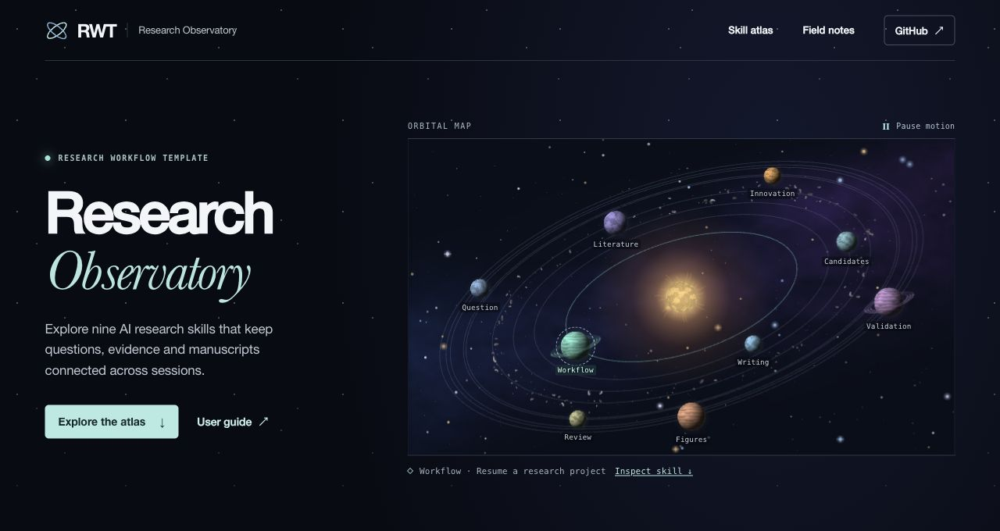
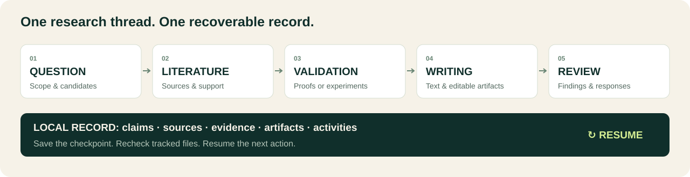
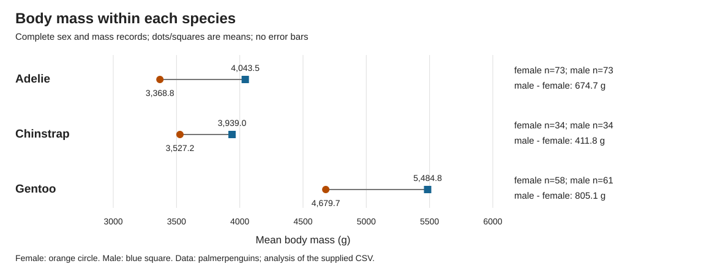

<div align="center">

[简体中文](docs/i18n/README.zh-CN.md) · [English](README.en.md) · [Русский](docs/i18n/README.ru.md) · [日本語](docs/i18n/README.ja.md)

<a href="https://cheshirecat-d.github.io/research-workflow-template/">
  <picture>
    <source media="(prefers-reduced-motion: no-preference)" srcset="docs/assets/research-observatory.webp">
    
  </picture>
</a>

# RWT · Research Workflow Template

**Keep your question, evidence, manuscript and next action in one local project.**

[](https://github.com/CheshireCat-D/research-workflow-template/actions/workflows/check.yml) [](https://www.python.org/downloads/) [](LICENSE)

[Explore the live observatory](https://cheshirecat-d.github.io/research-workflow-template/) · [Download the runtime](https://github.com/CheshireCat-D/research-workflow-template/releases/latest/download/research-workflow-template.zip) · [Quick start](#start-a-project) · [Full user guide](USER_GUIDE.en.md) · [Real example](#see-a-complete-research-record) · [External skill comparison](docs/13-research-skill-landscape.md)

</div>

RWT is an open-source research workflow toolkit for use with an AI assistant. Nine skills guide the research work; standard-library Python tools maintain claims, sources, evidence, artifacts and recovery state. It covers sciences, engineering, health, agriculture, humanities, social sciences and law.

| Work from question to manuscript | Connect claims to evidence | Continue in a new session |
|---|---|---|
| Use one project for literature, validation, writing, figures and review. | Record supporting material and inspect changes to tracked files. | Recheck the saved state, see open issues, and recover the next action. |



Full user guides are available in Chinese and English; Russian and Japanese pages provide a quick start. The graphics illustrate the workflow; work is performed through your AI assistant and the CLI. Detailed technical documents currently remain in Chinese.

## Start a project

Download the [current user runtime](https://github.com/CheshireCat-D/research-workflow-template/releases/latest/download/research-workflow-template.zip) and its [SHA-256 file](https://github.com/CheshireCat-D/research-workflow-template/releases/latest/download/research-workflow-template.zip.sha256). One current release is maintained; GitHub's separate source download also contains development tests. See the [skill selection and design influences](docs/12-skills-selection.md) for integration choices.

Verify the SHA-256, extract the ZIP, and open a terminal in the package root containing `tools/`. Use Python 3.11+ on Windows, macOS or Linux. See the [platform validation record](docs/11-linux-validation.md) for actual execution evidence. The commands below use macOS/Linux syntax.

```sh
python3 tools/research.py init --output ../my-research --title 'My research question' --connect-skills
```

On Windows PowerShell, run the same tools with the Python launcher:

```powershell
py -3 -X utf8 tools/research.py init --output "../my-research" --title "My research question" --connect-skills
```

Check `py -3 --version` for Python 3.11 or later. If the launcher is unavailable, replace `py -3` with the installed `python`. Project-root arguments may use native paths; material paths stored inside project records use `/` on every platform.

Choose a new output directory. Open that project in a compatible skill host and describe the current task. Existing research can resume at the relevant activity. Initial installation refuses existing targets; explicit upgrades preserve local edits by refusing a modified bundle. Global skills and the separate personal package remain independent.

`--connect-skills` installs into this new project only. If initialization succeeds but connection fails, resolve the returned error, then run `python3 tools/connect_skills.py install --root ../my-research` from the original package directory, using the actual project path. On Windows, replace the Python launcher as described above. Do not initialize the project again. The separate setup commands remain supported.

To create a complete example, including analysis, editable figures, registered evidence and recovery state, run:

```sh
python3 -B examples/public-penguins/run_project.py --output ../penguins-project
```

This downloads one pinned CC0 CSV. Use `--input FILE` for an offline local CSV; the output records whether it matches the pinned public input. The example's required resources are included in the user ZIP.

From the created research project's root, recover context with:

```sh
python3 .agents/skills/_rw-runtime/tools/research.py resume --format markdown
```

On Windows, replace `python3` with `py -3 -X utf8`. Under the same script entry point, use `show --edit evidence:E1 activity:A1` to export several editable records with their versions, then `register-batch --file EDIT.json --next-action "..."` to save registrations, a checkpoint and an inspected recovery summary together. Existing projects must explicitly upgrade their project-local runtime to use these options. Use `configure` for supported settings. [CLI usage](docs/07-core-usage.md) and [skill connection](docs/08-skills-and-methods.md) document the contracts and directory-switch recovery limits.

An agent with local file and command access can read the user guide, then start from:

> My discipline / research area is […], my current interests and ideas are […], my existing knowledge, literature, materials and available resources are […], my time limit is […], and I hope to publish in the journal […].

Ask the assistant to save the research constraints and return the actual path to the first saved output, a short conclusion and the next action. The user guide covers existing materials, registration and record corrections.

If the journal is undecided, write “undecided” and continue the research already possible. The target journal guides audience, scope and submission requirements; it is not an acceptance prediction.

`rw-review` supports structured review, optional isolated simulated reviewers, point-by-point responses and submission preparation. Open the [local review desk](skills/rw-review/references/review-desk.md) to compare figures, save feedback and share the selected manuscript and files. The [ozone revision example](examples/ozone-revision/README.md) shows which estimates and figures need updating after a measurement changes.

For a Chinese degree thesis, use the [school-specific delivery check](skills/rw-writing/references/thesis-delivery-zh.md) to compare the editable manuscript, its PDF and the applicable requirements.

Follow the [paired-pen calculation](examples/paired-pens/README.md) to reproduce the promotional example, then generate [aligned tables and editable manuscript source](examples/submission-table/README.md). The [research-quality tasks](evals/quality/README.md) record real retrieval, correct/defective review controls and a recommendation revised after resources changed.

The [first-use exercises](evals/usability/README.md) record two isolated AI-agent scenarios and the resulting offline-guide improvement; human feedback is collected separately. A [public penguin-data case](examples/public-penguins/README.md) adds an actual observational analysis, independent base-R checks and documented project recovery.

## See a complete research record

The [public penguin-data example](examples/public-penguins/README.md) produces analysis, SVG figures, a short results draft, registered sources and evidence, and a recoverable project in one command. The figure below is an existing descriptive-analysis artifact from that public-data example. Its source and reproduction steps are documented in the example.



Explore the [paired-pen example](examples/paired-pens/README.md) and [aligned tables with LaTeX manuscript source](examples/submission-table/README.md) for further outputs. Each example states the scope of its results.

## Nine focused research skills

| Skill | Purpose |
|---|---|
| [`rw-workflow`](skills/rw-workflow/SKILL.md) | Coordinate work and resume projects |
| [`rw-question`](skills/rw-question/SKILL.md) | Frame the question and constraints |
| [`rw-literature`](skills/rw-literature/SKILL.md) | Find literature and position contributions |
| [`rw-innovation`](skills/rw-innovation/SKILL.md) | Develop testable research ideas |
| [`rw-candidates`](skills/rw-candidates/SKILL.md) | Compare candidate directions |
| [`rw-validation`](skills/rw-validation/SKILL.md) | Plan proof, experiment and method checks |
| [`rw-writing`](skills/rw-writing/SKILL.md) | Structure arguments and write manuscripts |
| [`rw-figures`](skills/rw-figures/SKILL.md) | Create plots and editable schematics |
| [`rw-review`](skills/rw-review/SKILL.md) | Review, revise and prepare submission materials |

[Research skill landscape](docs/13-research-skill-landscape.md) compares PaperSpine5 and other external candidates by purpose, license and fit. The comparison is a discovery reference, not a list of bundled dependencies.

## Checks and evidence

```sh
python3 -B tools/check_core.py --test-timeout 360
python3 -B tools/release_package.py check
python3 -B tools/package_user.py check
```

[Current checks](evals/current/latest.json), [release acceptance](docs/10-release-readiness.md) and [platform validation](docs/11-linux-validation.md) distinguish executed environments from untested targets. Synthetic tasks, original real-source notes, frozen evidence and regression fixtures remain in the source repository's `evals/`. The user ZIP omits these development materials; the release guide gives its build and clean-runtime commands.

The core performs local registration and inspection, without executing commands embedded in sources, uploading data or submitting manuscripts. Software success is separate from scientific validity, ethics approval and venue compliance. The tool does not include a model API or a background research service. Hosted CI success must be established by an actual repository run.

Original implementation, guidance and synthetic examples use the [MIT license](LICENSE). Linked external works retain their own rights; see [provenance](provenance/ORIGIN.md), [method sources](profiles/sources.json), [contribution guidance](CONTRIBUTING.md) and [security boundaries](SECURITY.md). Creating or publishing a remote repository is a separate action.
