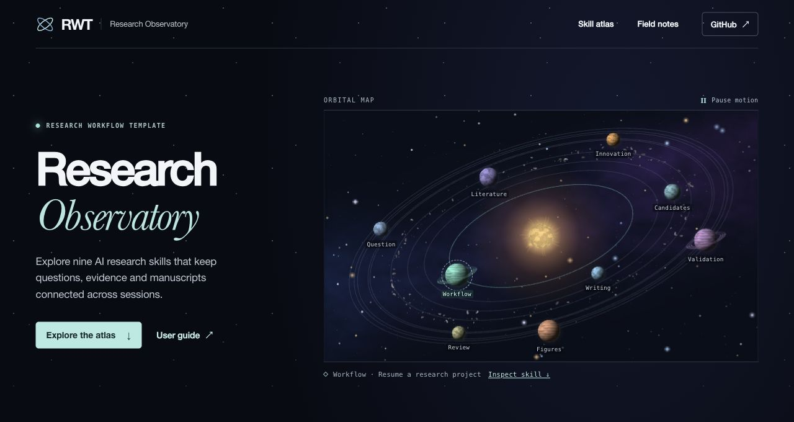

<div align="center">

<h1>RWT · Research Workflow Template</h1>

<h3>One local workflow for research, writing and revision.</h3>

<p>Work with your AI assistant. Keep your evidence, manuscript and next action in one resumable project.</p>

<p>
  <a href="https://github.com/CheshireCat-D/research-workflow-template/actions/workflows/check.yml"></a>
  <a href="https://www.python.org/downloads/"></a>
  <a href="skills"></a>
  <a href="LICENSE"></a>
</p>

<p><strong>
  <a href="https://cheshirecat-d.github.io/research-workflow-template/">Website</a> ·
  <a href="USER_GUIDE.en.md">User guide</a> ·
  <a href="https://github.com/CheshireCat-D/research-workflow-template/releases/latest/download/research-workflow-template.zip">Download</a> ·
  <a href="#try-a-research-case">Research examples</a>
</strong></p>

<p>
  <a href="README.md">English</a> ·
  <a href="docs/i18n/README.zh-CN.md">简体中文</a> ·
  <a href="docs/i18n/README.ru.md">Русский</a> ·
  <a href="docs/i18n/README.ja.md">日本語</a>
</p>

<p>
  <a href="#start-a-project">Quick start</a> ·
  <a href="skills">Nine research skills</a> ·
  <a href="evals/current/README.md">Validation</a>
</p>

</div>

<a href="https://cheshirecat-d.github.io/research-workflow-template/">
  <picture>
    <source media="(prefers-reduced-motion: no-preference)" srcset="docs/assets/research-observatory.webp">
    
  </picture>
</a>

RWT is an open-source toolkit for working on a research project with an AI assistant. It keeps your question, sources, evidence, decisions and next action in a local project you can reopen. Select a research skill in the observatory to see its purpose and open its instructions.

## Try a research case

| Research question | What you can inspect |
| --- | --- |
| Which conclusions change after one ozone reading changes? | [Recompute three estimates, check the brief and figure, and render the revised PDF](examples/ozone-revision/README.md). |
| Which sources support a claim about particle ejection from asteroid Bennu? | Follow an [English literature-screening example](docs/literature-screening/README.md). Record why each candidate was included, excluded or left open, then carry those decisions into a project checkpoint. The example and its helper are available in the source repository. |
| How does penguin body mass vary between species in the observed sample? | Reproduce the [public-data analysis](examples/public-penguins/README.md), inspect its figure and registered evidence, then resume the project. The runtime ZIP includes this example. |

## Start a project

Open RWT in an assistant with local file and command access and describe the work you want done. The assistant can set up the project, revise files and save a recoverable next action. The web review view is available when you want it. The command below is also available for manual setup.

Download the [runtime ZIP](https://github.com/CheshireCat-D/research-workflow-template/releases/latest/download/research-workflow-template.zip) and [SHA-256 checksum](https://github.com/CheshireCat-D/research-workflow-template/releases/latest/download/research-workflow-template.zip.sha256). Verify the checksum and extract the ZIP. In the directory containing `tools/`, run this with Python 3.11 or later.

```sh
python3 tools/research.py init --output ../my-research --title "My research question" --connect-skills
```

Use a new output directory. On Windows, replace `python3` with `py -3 -X utf8`. Open the created project in a compatible AI assistant. To pick up in a later session, run the following from that project's root.

```sh
python3 .agents/skills/_rw-runtime/tools/research.py resume --format markdown
```

## Explore the project

- [English workflow overview](README.en.md) and [complete user guide](USER_GUIDE.en.md)
- [Read a literature folder, find original sources and verify citations](skills/rw-literature/references/search-and-library.md)
- [Review a manuscript revision, compare figures and package the selected files](skills/rw-review/references/review-desk.md)
- [Check a Chinese degree thesis against its institution’s requirements](skills/rw-writing/references/thesis-delivery-zh.md)
- [All nine research skills](skills), from framing a question to responding to review
- [Validation records](evals/current/README.md), [platform checks](docs/11-linux-validation.md) and [source attribution](provenance/ORIGIN.md)
- [External research skill comparison](docs/13-research-skill-landscape.md) (in Chinese)

Documentation is also available in [Chinese](docs/i18n/README.zh-CN.md), [Russian](docs/i18n/README.ru.md) and [Japanese](docs/i18n/README.ja.md). Russian and Japanese cover getting started.

[MIT license](LICENSE) · [Contributing](CONTRIBUTING.md) · [Security](SECURITY.md)
