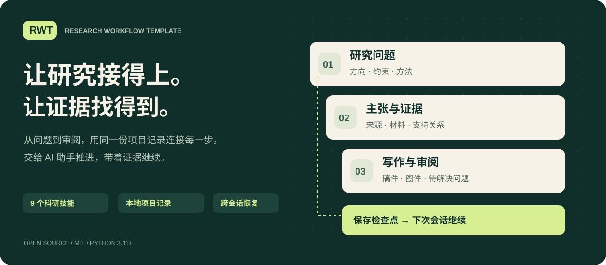
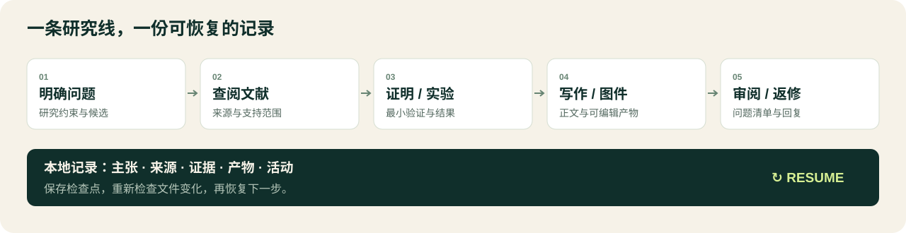
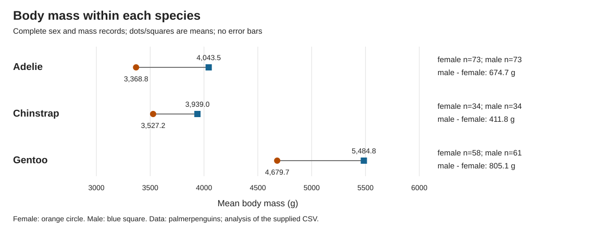

<div align="center">

[简体中文](README.md) · [English](README.en.md) · [Русский](docs/i18n/README.ru.md) · [日本語](docs/i18n/README.ja.md)



# RWT · 科研工作流工具包

**配合 AI 助手，把研究问题、证据、稿件和下一步留在同一个项目里。**

[](https://github.com/CheshireCat-D/research-workflow-template/actions/workflows/check.yml) [](https://www.python.org/downloads/) [](LICENSE)

[下载当前运行包](https://github.com/CheshireCat-D/research-workflow-template/releases/latest/download/research-workflow-template.zip) · [开始使用](#开始使用) · [完整中文指南](中文介绍与使用说明.md) · [实际案例](#看一次完整研究记录) · [外部技能对比](docs/13-research-skill-landscape.md)

</div>

研究推进到哪里、哪个结论由什么材料支持、换个会话从哪里继续——RWT 帮你把这些保存在本地。九个科研技能指导 AI 助手完成任务，Python 工具维护项目记录与检查点，适合理工医农、人文社科与法学研究。

| 提出问题到完成稿件 | 材料与结论连得上 | 下次会话接着做 |
|---|---|---|
| 选题、文献、验证、写作、图件和审阅，共用同一个项目。 | 保存主张、来源、证据和产物，检查已登记材料的变化。 | 恢复前重查记录与文件，显示已保存的进度、待解决问题和下一步。 |



中文与英文提供完整用户指南；俄语与日语提供入门页。上图为工作流示意，实际操作通过 AI 助手与命令行完成。

## 开始使用

直接使用可下载[当前用户运行包](https://github.com/CheshireCat-D/research-workflow-template/releases/latest/download/research-workflow-template.zip)与[SHA-256](https://github.com/CheshireCat-D/research-workflow-template/releases/latest/download/research-workflow-template.zip.sha256)。发行入口只维护一个当前包；GitHub 的源码下载另含开发测试材料。

下载后核对 SHA-256，解压 ZIP，再在包含 `tools/` 的目录打开终端。需要 Python 3.11 或更新版本。核心提供 Windows、macOS 与 Linux 本地项目支持；各平台的实际执行记录见[平台核验](docs/11-linux-validation.md)。macOS/Linux 在本目录运行：

```sh
python3 tools/research.py init --output ../my-research --title '我的研究问题' --connect-skills
```

Windows PowerShell 可运行同一组命令：

```powershell
py -3 -X utf8 tools/research.py init --output "../我的研究" --title "我的研究问题" --connect-skills
```

先用 `py -3 --version` 确认 Python 为 3.11 或更新版本；若没有 `py` 启动器，把 `py -3` 换成已安装的 `python`。命令中的项目根路径可使用系统惯用路径，登记材料的项目相对路径统一用 `/`。

将输出路径换成尚不存在的新目录。然后在 Codex 等兼容宿主中打开新项目，描述研究兴趣或当前任务即可。已有项目先运行 `resume`。首次接入和显式升级分别保护已有目录与本地修改；不改全局技能或个人完整版。

日常在创建好的研究项目根目录运行以下命令，恢复上下文：

```sh
python3 .agents/skills/_rw-runtime/tools/research.py resume --format markdown
```

Windows 将 `python3` 换成 `py -3 -X utf8`。同一脚本入口下，`show --edit evidence:E1 activity:A1` 可一次导出带版本的待修改记录，`register-batch --file EDIT.json --next-action "…"` 可一次保存登记、检查点及恢复摘要。已有项目需显式升级项目内运行时后才能使用这些选项。完整命令见[核心用法](docs/07-core-usage.md)。

`--connect-skills` 只把技能接入这个新项目。若报告初始化成功而接入失败，按返回信息修复后，从原工具包目录运行 `python3 tools/connect_skills.py install --root ../my-research`，路径换成实际已创建的项目；Windows 按上述方式替换启动器。不重复初始化。原来的分步命令仍可使用。

想先看完整产物，可以运行随用户包附带的公开数据案例（联网下载固定的 CC0 输入）：

```sh
python3 -B examples/public-penguins/run_project.py --output ../penguins-project
```

它实际生成结果、可编辑图件、研究登记与恢复状态。已有本地 CSV 时可加 `--input FILE` 离线运行；输入是否匹配固定公开数据会单独记录。

也可以让具备本地文件与执行能力的 Agent 先读中文指南，再发送：

> 我的专业／研究方向是【……】，目前的兴趣和想法是【……】，已有知识、文献、材料与可用资源是【……】，时间限制是【……】，希望发表在【……】期刊。

请助手按指南保存研究约束，并交付首份成果的实际路径、简短结论和下一步。已有材料的接入、日常登记与纠错由助手按当前任务处理，具体步骤见使用说明。

尚未确定期刊时可以填“待定”，先推进当前可开展的研究。目标期刊用于核对读者、研究范围和投稿要求，不代表录用承诺。

`rw-review` 按需支持结构化评审、多视角隔离模拟审稿、逐条审稿回复和投稿材料准备。直接说明当前任务即可；具体用法见[完整指南](中文介绍与使用说明.md#审阅返修与投稿材料)。

## 看一次完整研究记录

[公开企鹅数据案例](examples/public-penguins/README.md)用一条命令生成分析结果、SVG 图件、结果简稿、来源与证据登记，以及可恢复的项目状态。下图是仓库已有的公开数据描述性分析产物，复算步骤与数据来源都在案例中。



也可以查看[配对栏演示](examples/paired-pens/README.md)与[结果表、LaTeX 稿源交付](examples/submission-table/README.md)。这些案例展示具体任务产物，结果支持范围以各案例说明为准。

## 九个技能，各有入口

| 技能 | 负责什么 |
|---|---|
| [`rw-workflow`](skills/rw-workflow/SKILL.md) | 协调任务与跨会话恢复 |
| [`rw-question`](skills/rw-question/SKILL.md) | 明确研究问题与约束 |
| [`rw-literature`](skills/rw-literature/SKILL.md) | 文献检索、来源与贡献定位 |
| [`rw-innovation`](skills/rw-innovation/SKILL.md) | 提出可检验的研究机制 |
| [`rw-candidates`](skills/rw-candidates/SKILL.md) | 比较与筛选候选方向 |
| [`rw-validation`](skills/rw-validation/SKILL.md) | 证明、实验与方法检查 |
| [`rw-writing`](skills/rw-writing/SKILL.md) | 组织论证与撰写稿件 |
| [`rw-figures`](skills/rw-figures/SKILL.md) | 数据图与可编辑示意图 |
| [`rw-review`](skills/rw-review/SKILL.md) | 审阅、返修与投稿材料 |

[科研技能来源与对比](docs/13-research-skill-landscape.md)整理 PaperSpine5 与其他候选项目的功能、许可和适用任务，供后续选择。它们是外部参考项目。

## 按需要查阅

| 文件 | 用途 |
|---|---|
| [中文介绍与使用说明](中文介绍与使用说明.md) | 从第一次启动到日常恢复、技能更新与交付 |
| [English user guide](USER_GUIDE.en.md) | 与中文指南对应的完整英文介绍与使用说明 |
| [命令行详细用法](docs/07-core-usage.md) | 查询、标准输入、原子批量登记、配置与检查点 |
| [技能与方法](docs/08-skills-and-methods.md) | 九个技能、项目内接入、方法资源与升级边界 |
| [技能检索与取舍](docs/12-skills-selection.md) | 已核验来源、选择理由与未采用边界 |
| [学科适配](docs/02-disciplinary-adaptation.md) | 七类学科、十类方法及跨学科组合 |
| [专业与问题导航](profiles/selection.md) | 教育、经管、心理、哲学与艺术的现有入口及未专测范围 |
| [配对栏饲喂演示](examples/paired-pens/README.md) | 从120条合成记录复算海报同例的栏均值、区间与精确P值 |
| [结果表与稿源交付](examples/submission-table/README.md) | 将同例数据整理成小数对齐的三线表与可编译主稿 |
| [科研质量实作](evals/quality/README.md) | 真实检索、正确稿/缺陷稿审阅及资源改变后的推荐调整 |
| [首次使用与反馈](evals/usability/README.md) | 两个隔离代理情境、发现的离线登记卡点及真人反馈入口 |
| [公开实测数据案例](examples/public-penguins/README.md) | 企鹅体质量分析、分层与缺失处理、独立 R 核对及恢复验证记录 |
| [法学项目模板](profiles/templates/legal-research.md) | 法域、法条时效、效力依据、判例与引证台账 |
| [证据契约](docs/03-evidence-contract.md) | 主张、材料、支持关系和研究进度的边界 |
| [当前验收](evals/current/latest.json) | 当前内容的实际检查结果与执行范围 |
| [发行验收](docs/10-release-readiness.md) | 来源、归档、干净环境与可交付检查 |
| [用户包指南](docs/user-package-guide.md) | 最终用户 ZIP 随附的简洁使用说明 |
| [平台核验](docs/11-linux-validation.md) | 实际平台范围、复查方法与未测环境 |

## 检查与边界

```sh
python3 -B tools/check_core.py --test-timeout 360
python3 -B tools/release_package.py check
python3 -B tools/package_user.py check
```

命令行离线工作，不执行材料中的命令、不上传数据或自动投稿。登记或软件检查通过不认证证明、创新性、伦理批准或期刊合规；相应检查仍由作者与实际执行者负责。源码中的 `evals/` 保留当前回归所需的合成任务、真实来源笔记及复核证据，用户 ZIP 不包含这些开发材料。构建与干净运行命令见[发行验收](docs/10-release-readiness.md)。

原创实现、指导与合成材料采用[MIT许可证](LICENSE)。外部方法资料保留自身权利，见[来源说明](provenance/ORIGIN.md)与[方法来源](profiles/sources.json)。维护流程见[贡献说明](CONTRIBUTING.md)，数据边界见[安全说明](SECURITY.md)。本目录与个人包独立，远程发布由维护者显式执行。
