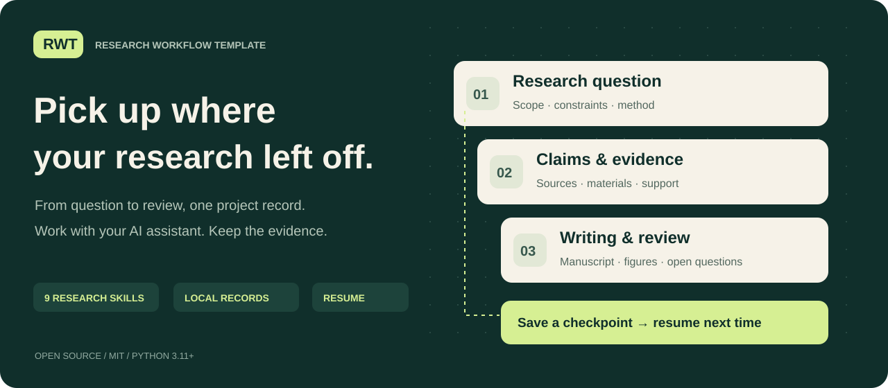

[中文](README.zh-CN.md) · [English](../../README.en.md) · [Русский](README.ru.md) · **日本語**



# RWT · 研究ワークフローテンプレート

**研究の問いから、根拠のある成果と、次回に引き継げる記録へ。**

RWT（Research Workflow Template）は、AI アシスタントと研究を進めるためのオープンソースのツールキットです。9 つのスキルが、問いの整理、文献調査、アイデアの検証、執筆、図の作成、レビューを支援します。Python 標準ライブラリで動くローカルのツールが、主張、出典、資料、成果物、進捗、再開に必要な状態を保存します。実際の研究作業は、利用する環境の AI アシスタントが行います。

[実行用 ZIP をダウンロード](https://github.com/CheshireCat-D/research-workflow-template/releases/latest/download/research-workflow-template.zip) · [SHA-256](https://github.com/CheshireCat-D/research-workflow-template/releases/latest/download/research-workflow-template.zip.sha256) · [英語の完全ガイド](../../USER_GUIDE.en.md) · [公開データの実行例](../../examples/public-penguins/README.md)

## RWT でできること

- **主張と資料を結び付ける。** どの出典や結果が主張を支え、何が未確認なのかを記録できます。
- **別のセッションで研究を再開する。** `resume` が保存済みのプロジェクトを読み、登録されたファイルの変化、チェックポイント、次の作業を確認します。
- **スキルをプロジェクト内に配置する。** 作業手順と共通の Python ツールをプロジェクトにコピーするため、元のテンプレートの場所に依存せず再開できます。

## はじめに

**Python 3.11 以上**と、ローカルファイルの操作、コマンドの実行、プロジェクト内スキルの読み込みができる AI アシスタントが必要です。RWT のコアは Python 標準ライブラリだけで動きます。アシスタントの実行環境や個別の研究ツールには、それぞれ別の要件があります。

上のリンクから ZIP と SHA-256 ファイルをダウンロードし、チェックサムを確認してから ZIP を展開します。ターミナルで、**展開したパッケージのルート（`tools` フォルダーがある場所）**を開いてください。

macOS / Linux:

```sh
python3 tools/research.py init --output ../my-research --title '私の研究課題' --connect-skills
```

Windows PowerShell:

```powershell
py -3 -X utf8 tools/research.py init --output "../my-research" --title "私の研究課題" --connect-skills
```

出力先の `my-research` は、まだ存在しない新しいフォルダーを指定します。親フォルダーは存在している必要があります。`python3 --version` または `py -3 --version` でバージョンを確認してください。Windows で `py` が使えない場合は、Python 3.11 以上に対応する `python` コマンドに置き換えます。

次に、**作成した研究プロジェクトのフォルダー**を Codex などの対応するアシスタント環境で開き、作業を依頼します。

> 私の研究分野は［…］です。手元には［…］があり、今は［…］を進めたいです。期限は［…］です。まずプロジェクト内の資料を確認し、次に必要な作業を実行して結果を保存してください。保存先、簡潔な結論、次の作業を教えてください。

`--connect-skills` は、このプロジェクト内にスキルを配置します。プロジェクトの作成に成功してスキルの接続だけが失敗した場合は、表示された原因を解消し、[ガイド](../../USER_GUIDE.en.md)の接続手順に従ってください。プロジェクトを作り直す必要はありません。

## 次のセッションで再開する

**作成した研究プロジェクトのルート**から、次を実行します。

```sh
python3 .agents/skills/_rw-runtime/tools/research.py resume --format markdown
```

Windows では `python3` を `py -3 -X utf8` に置き換えてください。保存された研究上の制約、記録、チェックポイント、検出された変更、次の作業を確認できます。`resume` 自体は読み取りと確認を行うコマンドです。その結果を踏まえ、アシスタントに研究の続きを依頼します。ファイルの変更が見つかった場合は、先に指摘内容を確認してください。

## 9 つのスキル

| スキル | 主な用途 |
|---|---|
| [`rw-workflow`](../../skills/rw-workflow/SKILL.md) | 研究全体の進行と再開 |
| [`rw-question`](../../skills/rw-question/SKILL.md) | 研究の問いと範囲の整理 |
| [`rw-literature`](../../skills/rw-literature/SKILL.md) | 文献調査、出典の確認、主張との対応付け |
| [`rw-innovation`](../../skills/rw-innovation/SKILL.md) | メカニズム、仮説、構成の検討 |
| [`rw-candidates`](../../skills/rw-candidates/SKILL.md) | 複数の研究方向の比較と選択 |
| [`rw-validation`](../../skills/rw-validation/SKILL.md) | 証明、計算、実験、解釈の検証 |
| [`rw-writing`](../../skills/rw-writing/SKILL.md) | 執筆、推敲、翻訳、要約 |
| [`rw-figures`](../../skills/rw-figures/SKILL.md) | データ図、編集可能な模式図、図の点検 |
| [`rw-review`](../../skills/rw-review/SKILL.md) | 自己点検、模擬査読、回答書、提出資料の準備 |

必要な作業に合わせてスキルを使います。小さな修正のたびに全工程を実行する必要はありません。自然科学、工学、医学、農学、人文科学、社会科学、法学向けの方法ガイドがあり、実際に検証した範囲は各記録に記載しています。

## 公開データで試す

**RWT パッケージのルート**から実行します。

```sh
python3 -B examples/public-penguins/run_project.py --output ../penguins-project
```

固定された版のペンギンの公開データ（CC0）を 1 つ取得して SHA-256 を確認し、記述的な分析を行います。表、SVG の図、中国語の短い結果文、研究記録、チェックポイントを生成します。インターネット接続が必要で、出力先には新しいフォルダーを指定します。対応する CSV が手元にある場合は `--input FILE` を追加すると、ダウンロードせずに実行できます。

データの範囲、分析上の制約、再実行方法は[実行例の説明](../../examples/public-penguins/README.md)を参照してください。これはワークフローを再現するための例であり、そのまま新しい研究論文になるものではありません。

## ドキュメントと言語対応

このページは日本語の入門ガイドです。完全なユーザーガイドは[中国語](../../中文介绍与使用说明.md)と[英語](../../USER_GUIDE.en.md)で提供しています。詳細な技術文書とスキル本文の多くは中国語です。日本語・ロシア語の入口ページは、パッケージ全体の翻訳を意味しません。

- [コマンドとチェックポイント](../07-core-usage.md)
- [スキルの接続と更新](../08-skills-and-methods.md)
- [各プラットフォームでの検証](../11-linux-validation.md)
- [データとセキュリティの方針](../../SECURITY.md)

RWT は記録を保存し、その整合性を確認します。ソフトウェアのチェックに合格しても、証明の正しさ、新規性、倫理審査の承認、投稿先の要件への適合が保証されるわけではありません。模擬査読も実際の編集判断とは異なります。コア自体は論文の投稿や研究資料のアップロードを行いません。外部サービスの利用範囲は、アシスタントの環境と依頼内容によって変わります。

[MIT ライセンス](../../LICENSE) · [出典と帰属](../../provenance/ORIGIN.md) · [貢献するには](../../CONTRIBUTING.md)
