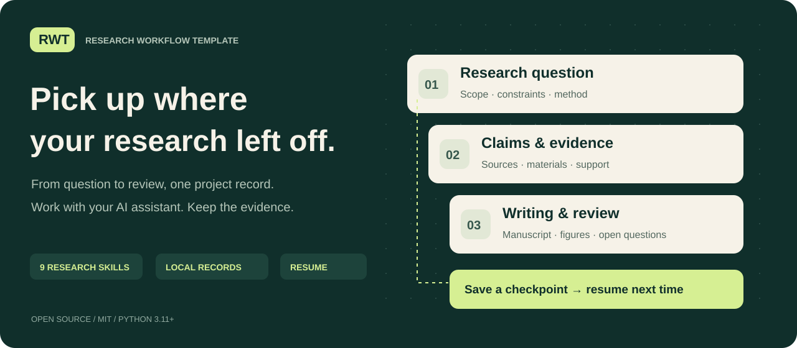

[中文](README.zh-CN.md) · [English](../../README.en.md) · **Русский** · [日本語](README.ja.md)



# RWT · Рабочий процесс исследования

**От исследовательского вопроса к результатам, источникам и следующему шагу, к которому можно вернуться.**

RWT (Research Workflow Template) — открытый набор инструментов для работы над исследованием вместе с ИИ-помощником. Девять навыков (skills) помогают формулировать вопросы, изучать литературу, проверять идеи, писать, создавать иллюстрации и разбирать замечания. Локальные инструменты на стандартной библиотеке Python сохраняют утверждения, источники, материалы, результаты и состояние проекта. Само исследование выполняет помощник в выбранной пользователем среде.

[Скачать пакет](https://github.com/CheshireCat-D/research-workflow-template/releases/latest/download/research-workflow-template.zip) · [SHA-256](https://github.com/CheshireCat-D/research-workflow-template/releases/latest/download/research-workflow-template.zip.sha256) · [Полное руководство на английском](../../USER_GUIDE.en.md) · [Пример с открытыми данными](../../examples/public-penguins/README.md)

## Что даёт RWT

- **Связь выводов с материалами.** Сохраняет, какие источники и результаты относятся к утверждению и что ещё нужно проверить.
- **Продолжение работы между сессиями.** Команда `resume` читает сохранённый проект, проверяет зарегистрированные файлы и показывает состояние контрольной точки и следующий шаг.
- **Навыки внутри проекта.** Рабочие инструкции и общий Python-инструментарий копируются в проект, чтобы продолжать работу без исходной папки шаблона.

## Быстрый старт

Нужны **Python 3.11 или новее** и ИИ-помощник, который умеет работать с локальными файлами, выполнять команды и загружать навыки проекта. Для ядра RWT достаточно стандартной библиотеки Python. Среда помощника и отдельные исследовательские инструменты могут иметь собственные требования.

Скачайте ZIP и файл SHA-256 по ссылкам выше, проверьте контрольную сумму и распакуйте архив. Откройте терминал **в корне распакованного пакета**, где находится папка `tools`.

В macOS или Linux:

```sh
python3 tools/research.py init --output ../my-research --title 'Мой исследовательский вопрос' --connect-skills
```

В Windows PowerShell:

```powershell
py -3 -X utf8 tools/research.py init --output "../my-research" --title "Мой исследовательский вопрос" --connect-skills
```

Папка `my-research` должна быть новой, а её родительская папка — уже существовать. Проверьте версию через `python3 --version` или `py -3 --version`. Если в Windows нет команды `py`, используйте `python`, настроенный на Python 3.11 или новее.

Затем откройте **созданную папку проекта** в совместимой среде ИИ-помощника, например Codex, и опишите задачу:

> Я исследую […]. У меня есть […]. Сейчас нужно […]. Срок — […]. Сначала прочитай материалы проекта, выполни ближайший полезный шаг и сохрани результат. Сообщи путь к файлу, краткий вывод и что делать дальше.

Параметр `--connect-skills` подключает навыки к этому проекту. Если проект создан, но подключение навыков завершилось ошибкой, исправьте указанную причину и используйте процедуру подключения из [руководства](../../USER_GUIDE.en.md); повторно создавать проект не нужно.

## Продолжить в новой сессии

В терминале **из корня созданного исследовательского проекта** выполните:

```sh
python3 .agents/skills/_rw-runtime/tools/research.py resume --format markdown
```

Для Windows замените `python3` на `py -3 -X utf8`. Помощник получает сохранённые ограничения, состояние записей и контрольной точки, обнаруженные изменения и следующий шаг. `resume` только читает и проверяет проект; продолжение исследования поручается помощнику отдельным запросом. Если файлы изменились, сначала разберите замечания проверки.

## Девять навыков

| Навык | Для чего нужен |
|---|---|
| [`rw-workflow`](../../skills/rw-workflow/SKILL.md) | Организация исследования и продолжение работы |
| [`rw-question`](../../skills/rw-question/SKILL.md) | Формулировка вопроса и границ задачи |
| [`rw-literature`](../../skills/rw-literature/SKILL.md) | Поиск литературы, проверка источников и их связи с выводами |
| [`rw-innovation`](../../skills/rw-innovation/SKILL.md) | Разработка механизмов, гипотез и конструкций |
| [`rw-candidates`](../../skills/rw-candidates/SKILL.md) | Сравнение и отбор исследовательских направлений |
| [`rw-validation`](../../skills/rw-validation/SKILL.md) | Проверка доказательств, расчётов, экспериментов и интерпретаций |
| [`rw-writing`](../../skills/rw-writing/SKILL.md) | Написание, редактирование, перевод и сокращение текста |
| [`rw-figures`](../../skills/rw-figures/SKILL.md) | Графики, редактируемые схемы и проверка иллюстраций |
| [`rw-review`](../../skills/rw-review/SKILL.md) | Самопроверка, моделирование рецензирования, ответы и подготовка материалов |

Используйте навыки по задаче: для одной правки не требуется запускать весь процесс. Методы охватывают естественные, технические, медицинские, сельскохозяйственные, гуманитарные, социальные и правовые исследования; фактический объём проверок указан в документации.

## Попробовать на открытых данных

Из корня **пакета RWT** запустите:

```sh
python3 -B examples/public-penguins/run_project.py --output ../penguins-project
```

Команда скачивает одну фиксированную версию открытой таблицы о пингвинах (CC0), проверяет её SHA-256, выполняет описательный анализ и создаёт таблицы, SVG-графики, краткий текст результатов на китайском, записи проекта и контрольную точку. Нужен интернет; выходная папка должна быть новой. Для совместимого локального CSV добавьте `--input FILE`, чтобы выполнить пример без скачивания.

Состав данных, ограничения анализа и способ повторного запуска описаны в [примере](../../examples/public-penguins/README.md). Это воспроизводимая демонстрация рабочего процесса, а не готовая новая научная работа.

## Документация и границы

Эта страница — вводное руководство на русском. Полные пользовательские руководства доступны на [китайском](../../中文介绍与使用说明.md) и [английском](../../USER_GUIDE.en.md); большинство технических документов и текстов навыков — на китайском. Русская и японская страницы не означают полный перевод пакета.

- [Команды и контрольные точки](../07-core-usage.md)
- [Подключение и обновление навыков](../08-skills-and-methods.md)
- [Проверки на платформах](../11-linux-validation.md)
- [Ограничения работы с данными](../../SECURITY.md)

RWT сохраняет записи и проверяет их целостность. Успешная проверка программы сама по себе не подтверждает доказательство, научную новизну, этическое одобрение или соответствие требованиям журнала. Моделирование рецензирования не заменяет решение редакции. Ядро не отправляет рукописи и не загружает исследовательские материалы; работа с внешними сервисами зависит от выбранного помощника и порученных ему действий.

[Лицензия MIT](../../LICENSE) · [Происхождение материалов](../../provenance/ORIGIN.md) · [Участие в проекте](../../CONTRIBUTING.md)
