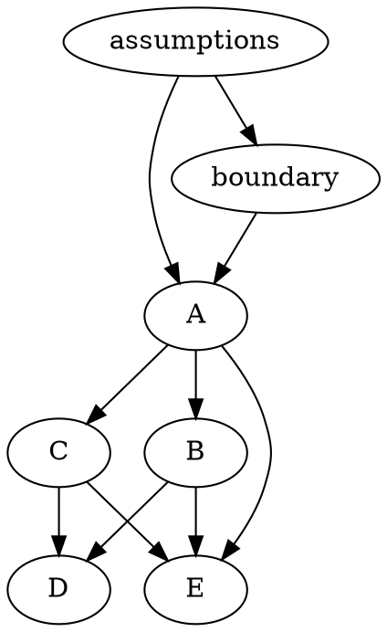

# Dependency graph and resolution

The assumptions and boundary definition are consistent. A establishes a certificate for a predictable intrinsic time satisfying SG and one fixed mixing distribution. B attempts to replace the intrinsic time, C the precision, without a certificate for the replacement. Their counterexamples invalidate those branches. D adds source restrictions contradicted by the originals. E is an implication conditional on actual simultaneous coverage; the valid A construction and the repaired constructions satisfy its premise.

All flagged obligations are resolved in error_table.md with exact draft lines and analytic witnesses. The four-step Bernoulli construction confirms B1; calculus plus the stipulated Rademacher LIL confirms C1; v=0 confirms C2; original-source conditions confirm D1. No circular proof is used and no undecided flag remains.

Repair dependencies: conditional Hoeffding CGF -> SG with V=t/4 -> A. The scalar logarithm inequality -> each one-step sub-exponential inequality -> two supermartingales -> fixed positive mixing -> two tail budgets alpha/2. For multiple normal precisions, individual A certificates -> countable union with budgets alpha*2^(-j). No passing compilation, numeric check, or source abstract is used as a mathematical proof.
