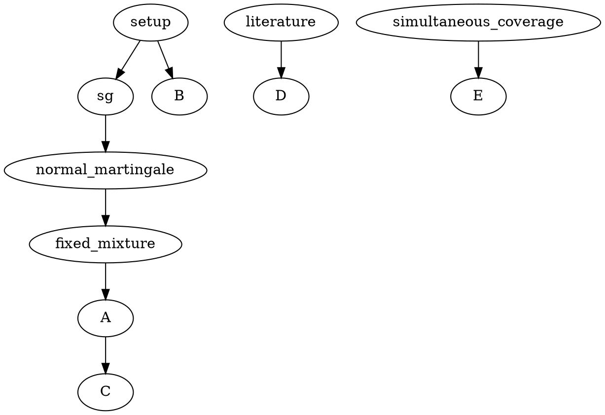

# 证明依赖与核查范围

基础层：适应观测、共同条件均值、过去均值预测器；附加 SG 条件仅用于 A。
中间层：固定指数超鞅、固定分布混合、Ville 不等式；结论层：A 的双尾同时覆盖及 E 的事件包含。
B 没有从适应性到 sub-Gaussian 超鞅支配的合法依赖边；C 没有从每个固定参数的有效性到参数下包络有效性的合法依赖边。D 须独立查原文。

已验证结构问题：E01（B 的超鞅条件缺失），E02（C 的调参量词变化），E03（D 的来源描述与优先权）。

三项均经原稿精确行号与解析证据验证；无循环依赖。B、C 所缺依赖不能由 E 补足。详见 error_table.md。
